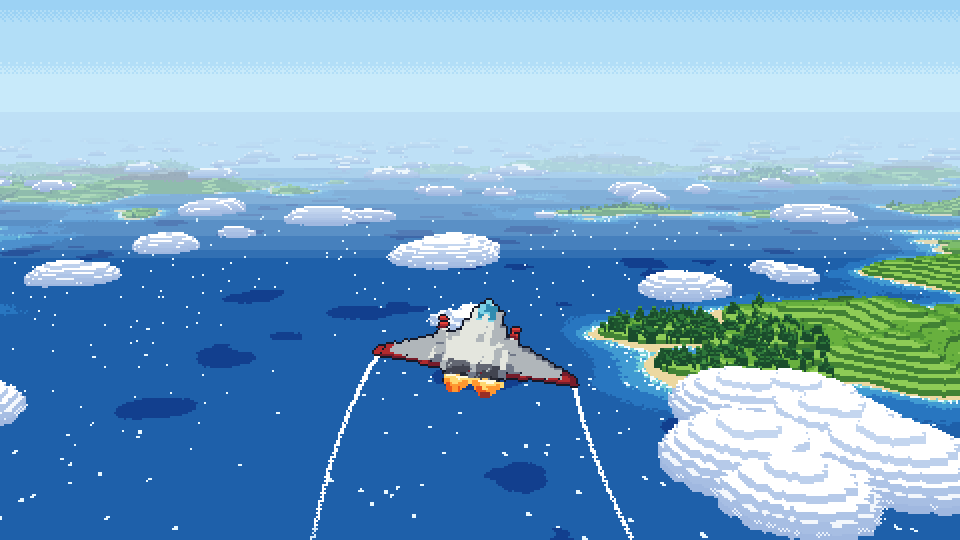
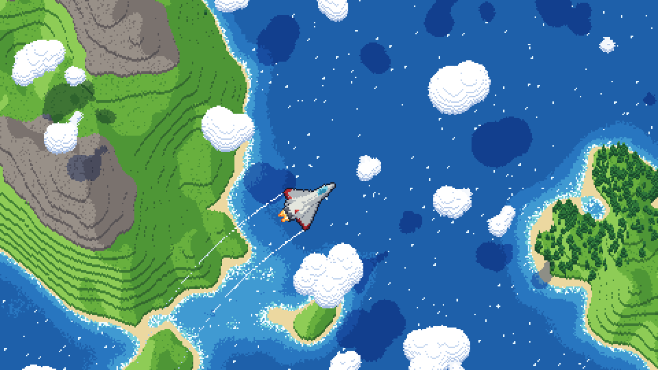

# sprite-stack-kit

A starter kit for building pixel-art games that look 3D without a 3D engine.

It gives you three things:

- **A small game you can fork.** `examples/starter` is a playable flight demo in about 1,800 lines of plain JavaScript. It uses no libraries, no build step and no image files.
- **Skills for coding agents.** `.agents/skills` teaches Claude Code, Codex, Cursor, Droid and other agents how the techniques work, so you can ask for "a boat game in this style" and get one.
- **A prompt library.** `prompts/` collects prompts people have shared for building games like this, with credit to their authors.



## Why this exists

On 15 November 2026, Dash ([@creativedash](https://x.com/creativedash)) posted [fighter](https://forge.ui8.ai/share/frag_1eb8944c-57b1-42ca-a909-5c2d7e517c24), a browser game, with the line ["No 3D engine, no polygons, 32 KB of code."](https://x.com/creativedash/status/2122000830895386680) A lot of people asked how it works and how to make their own.

This kit answers both questions. It explains the techniques, and it gives you a clean base to build on.

It is an independent project. It is not affiliated with Dash or UI8, and it contains none of Dash's code, artwork or sound. The starter was written for this kit after studying his published build, and it follows his approach closely. [CREDITS.md](CREDITS.md) says exactly what comes from where.

## Try it

You need [Node.js](https://nodejs.org) 20 or newer. There is nothing to install.

```sh
git clone https://github.com/RayFernando1337/sprite-stack-kit.git
cd sprite-stack-kit
npm start
```

Then open the address it prints (normally `http://localhost:5173`).

| Input | What it does |
| --- | --- |
| Move the pointer | Steer. In the chase view, point above the craft to climb and below it to dive |
| Click or tap | Barrel roll |
| Hold | Thrusters |
| Arrow keys or WASD | Turn, climb (W) and dive (S) |
| Shift | Thrusters |
| Space, or the VIEW button | Switch between the overhead view and the chase view |
| E | Pull the stack apart to see the slices |

Add `?seed=3` to the address for a different world, and `?view=chase` to start behind the craft.



## How the trick works

There are five ideas. [docs/how-it-works.md](docs/how-it-works.md) explains each one and points at the code.

1. **One small picture.** The whole game is drawn into an array of about 400 × 240 numbers, one per pixel. The page shows that picture scaled up by a whole number, with hard edges.
2. **Sprite stacking.** The craft is a pile of flat pixel pictures, one per layer of height. Drawn one pixel apart and turned together, the pile reads as a solid object.
3. **The world is stacks too.** Every ground pixel has a height. The ground is drawn from near to far, and each pixel is drawn as a column that many layers tall.
4. **One camera.** A single short formula gives both the flat overhead view and the view from behind. Changing view slides a few numbers, so there is never a cut.
5. **A depth for every pixel.** The picture remembers how far away each pixel is, so a hill or a cloud can hide the craft.

## Build your own game

**With a coding agent.** Open this folder in your agent. It reads [AGENTS.md](AGENTS.md) and the skills by itself. Then ask for what you want, for example:

- "Turn the craft into a hot-air balloon and make the islands a desert."
- "Add a cockpit view as a third camera view."
- "Add enemy boats that I can shoot."
- "Make a new game in `examples/` where I drive a boat between the islands."

**By hand.** Start with these three files in `examples/starter/src`:

- `model.js` shapes the craft and sets its colours.
- `world.js` makes the islands and clouds, and holds the world's palette.
- `game.js` holds how the craft flies and where the camera sits. The numbers in `TUNING` at the top are the quickest things to change.

**From a single prompt.** [prompts/](prompts/README.md) has complete prompts you can paste into a model to build a game like this from nothing.

## Study the original

Dash's game is public, so you can read it and run it on your own computer:

```sh
npm run fetch-reference   # downloads his published build into reference/ (git-ignored)
npm run reference         # serves that copy so you can play it locally
```

[docs/getting-the-source.md](docs/getting-the-source.md) explains what the Forge link is, why saving the page does not give you a working game, and what you may and may not do with the files. [docs/reference-map.md](docs/reference-map.md) says where each feature lives in his code.

His files are not part of this repository, and they were published without a license. Read them to learn. Do not copy from them or republish them. To build on his project itself, sign in to Forge and press **Remix** on [his page](https://forge.ui8.ai/share/frag_1eb8944c-57b1-42ca-a909-5c2d7e517c24).

## Check your changes

```sh
npm test          # runs the game with no browser and checks what the kit promises
npm run snapshot  # saves frames to snapshots/ so you (or your agent) can look at them
```

## What the starter does not have

It is a base, not a finished game. It has flight, two camera views, trails, flames, shadows and a wrapping world. It has no cockpit view, no combat, no sound, no gamepad support and no on-screen touch buttons apart from VIEW. Those are good first things to build, and the skills describe how.

## What is in the box

| Path | What it is |
| --- | --- |
| `examples/starter/` | The game to fork: 10 files, 66 KB with comments, 25 KB gzipped |
| `.agents/skills/` | Skills for coding agents, one folder each |
| `prompts/` | Prompts for building games like this, with credit |
| `docs/` | How it works, how to get the original's source, and a map of the original's code |
| `scripts/` | A local server, the checks, the snapshot tool and the reference downloader |
| `reference/` | Created by `npm run fetch-reference`. Git-ignored and never committed |

## Credits

This kit stands on other people's work. The short version:

- **Dash** ([@creativedash](https://x.com/creativedash)) made the game and the approach this kit teaches.
- **Levi 卧云** ([@Leviwoyun](https://x.com/Leviwoyun)) and **阿旭gogogo** ([@axu_ai](https://x.com/axu_ai)) shared the prompts they used to recreate it.
- **Del** ([@TheCartelDel](https://x.com/TheCartelDel)) gave the explanation, "sprite stacking", that most people learned the name from, in a thread started by **/OVRFLW** ([@overflowyouknow](https://x.com/overflowyouknow)).
- **Dilip** ([@dilip_ramirez](https://x.com/dilip_ramirez)) ported it to an ESP32-S3.

[CREDITS.md](CREDITS.md) has everyone, with links to their posts.

## License

The code and documents written for this kit are under the [MIT License](LICENSE).

The prompts in `prompts/` that were written by other people remain theirs. They are reproduced with credit and a link, and will be removed if their authors ask. Dash's game is not included here and the license does not cover it.
