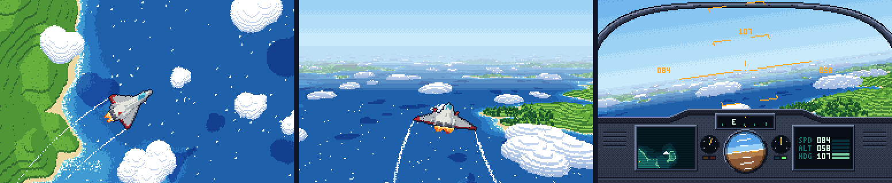
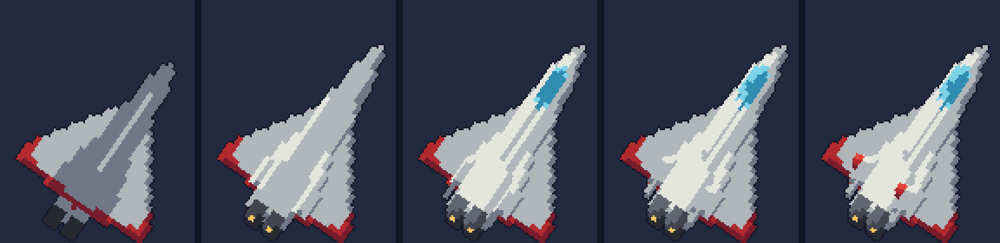

# sprite-stack-kit

Build pixel-art games that look 3D, with no 3D engine.



Every pixel in those three pictures was worked out by plain JavaScript. There are no polygons, no graphics library and no image files. This kit explains how that is done, and gives you a working game to take apart and make your own.

## What you get

- **A game to fork.** [`examples/starter`](examples/starter/README.md) is a small flight game with three camera views: from above, from behind, and from the cockpit. It is about 2,500 lines of commented JavaScript, with no libraries and no build step.
- **Documents that teach.** A [picture tour](docs/how-it-works.md) of the ideas, a [hands-on tutorial](docs/tutorial.md), and a [deeper look](docs/deep-dive.md) at the maths and the code.
- **Skills for coding agents.** [`.agents/skills`](.agents/skills) teaches Claude Code, Codex, Cursor, Droid and other agents the same techniques, so you can ask for "a boat game in this style" and get one.
- **A prompt library.** [`prompts/`](prompts/README.md) collects prompts people have shared for building games like this, with credit to their authors.

## Where it comes from

On 15 November 2026, Dash ([@creativedash](https://x.com/creativedash)) posted [fighter](https://forge.ui8.ai/share/frag_1eb8944c-57b1-42ca-a909-5c2d7e517c24), a browser game, with the line ["No 3D engine, no polygons, 32 KB of code."](https://x.com/creativedash/status/2122000830895386680) A lot of people asked how it works and how to make their own. This kit is an answer to both questions.

It is an independent project. It is not affiliated with Dash or UI8, and it contains none of Dash's code, artwork or sound. The starter was written for this kit after studying his published build, and it follows his approach closely. [CREDITS.md](CREDITS.md) says exactly what comes from where.

## Start here

You need [Bun](https://bun.sh). There is nothing else to install.

```sh
git clone https://github.com/RayFernando1337/sprite-stack-kit.git
cd sprite-stack-kit
bun start
```

Open the address it prints (normally `http://localhost:5173`) and fly.

| Input | What it does |
| --- | --- |
| Move the pointer | Steer. From behind and in the cockpit, point up to climb and down to dive |
| Click or tap | Barrel roll |
| Hold | Thrusters |
| Arrow keys or WASD | Turn, climb (W) and dive (S) |
| Shift | Thrusters |
| Space, or the VIEW button | The next view: overhead, chase, cockpit |
| E | Pull the stack apart to see the slices |

Add `?seed=3` to the address for a different world. Add `?view=chase` or `?view=cockpit` to start in that view.

## Pick a path

| If you want to | Go to |
| --- | --- |
| See how the trick works, in pictures | [docs/how-it-works.md](docs/how-it-works.md) |
| Change the game with your own hands, one small step at a time | [docs/tutorial.md](docs/tutorial.md) |
| Understand the maths and the code properly | [docs/deep-dive.md](docs/deep-dive.md) |
| Look up a word | [docs/glossary.md](docs/glossary.md) |
| Build with a coding agent | [Build your own game](#build-your-own-game), below |
| Build a game from a single prompt | [prompts/](prompts/README.md) |
| Read and run Dash's original | [docs/getting-the-source.md](docs/getting-the-source.md) |

## The trick, in six ideas



1. **One small picture.** The whole game is drawn into an array of about 400 × 240 numbers, one per pixel. The page shows that picture scaled up by a whole number, with hard edges.
2. **Sprite stacking.** The craft is a pile of flat pixel pictures, one per layer of height. The picture above adds them one at a time. Drawn one pixel apart and turned together, the pile reads as a solid object.
3. **The world is stacks too.** Every ground pixel has a height. The ground is drawn from near to far, and each pixel is drawn as a column that many layers tall.
4. **One camera.** A single short formula gives the flat view from above, the view from behind and the view from the cockpit. Changing view slides a few numbers, so there is never a cut.
5. **A depth for every pixel.** The picture remembers how far away each pixel is, so a hill or a cloud can hide the craft.
6. **A turned picture.** The ground can only be drawn upright. To bank the cockpit view, the world is drawn on a bigger sheet and the sheet is turned.

[docs/how-it-works.md](docs/how-it-works.md) explains each one with pictures and points at the code.

## Build your own game

**With a coding agent.** Open this folder in your agent. It reads [AGENTS.md](AGENTS.md) and the skills by itself. Then say what you want to see, for example:

- "Turn the craft into a hot-air balloon and make the islands a desert."
- "Add enemy boats that I can shoot."
- "Give the cockpit a radar screen that shows the boats."
- "Make a new game in `examples/` where I drive a boat between the islands."

[prompts/kit-prompts.md](prompts/kit-prompts.md) has longer requests that work well.

**By hand.** Follow [docs/tutorial.md](docs/tutorial.md). It takes you through eight small changes: a tuning number, the craft's colours and shape, the land, a tower on the map, the cockpit, and a copy of the game that is yours. Each step says which file to open and what you should see.

**From a single prompt.** [prompts/](prompts/README.md) has complete prompts you can paste into a model to build a game like this from nothing.

## Check your changes

```sh
bun run check      # runs the game with no browser and checks 41 things the kit promises
bun run snapshot   # saves frames to snapshots/ so you (or your agent) can look at them
bun test           # the same checks, through Bun's test runner
```

## Study the original

Dash's game is public, so you can read it and run it on your own computer:

```sh
bun run fetch-reference   # downloads his published build into reference/ (git-ignored)
bun run reference         # serves that copy so you can play it locally
```

[docs/getting-the-source.md](docs/getting-the-source.md) explains what the Forge link is, why saving the page does not give you a working game, and what you may and may not do with the files. [docs/reference-map.md](docs/reference-map.md) says where each feature lives in his code.

His files are not part of this repository, and they were published without a license. Read them to learn. Do not copy from them or republish them. To build on his project itself, sign in to Forge and press **Remix** on [his page](https://forge.ui8.ai/share/frag_1eb8944c-57b1-42ca-a909-5c2d7e517c24).

## What the starter has, and what it leaves for you

It is a base, not a finished game.

- **It has:** flight, three camera views with smooth moves between them, a cockpit with working instruments and a head-up display, trails, flames, shadows, and a world that wraps for ever.
- **It leaves for you:** enemies and weapons, crashes, sound, gamepad support, and on-screen touch buttons apart from VIEW. These are good first things to build, and the skills describe how.

## What is in the box

| Path | What it is |
| --- | --- |
| `examples/starter/` | The game to fork: 13 files, 99 KB with comments, 37 KB gzipped |
| `docs/` | The picture tour, the tutorial, the deeper look, the glossary, and how to get and read the original |
| `.agents/skills/` | Skills for coding agents, one folder each. They are plain how-to guides, so people can read them too |
| `prompts/` | Prompts for building games like this, with credit |
| `scripts/` | The local server, the checks, the snapshot tool, the figure maker and the reference downloader |
| `tests/` | Lets `bun test` run the checks |
| `reference/` | Created by `bun run fetch-reference`. Git-ignored and never committed |

## Credits

This kit stands on other people's work. The short version:

- **Dash** ([@creativedash](https://x.com/creativedash)) made the game and the approach this kit teaches.
- **Levi 卧云** ([@Leviwoyun](https://x.com/Leviwoyun)) and **阿旭gogogo** ([@axu_ai](https://x.com/axu_ai)) shared the prompts they used to recreate it.
- **Del** ([@TheCartelDel](https://x.com/TheCartelDel)) gave the explanation, "sprite stacking", that most people learned the name from, in a thread started by **/OVRFLW** ([@overflowyouknow](https://x.com/overflowyouknow)).
- **Dilip** ([@dilip_ramirez](https://x.com/dilip_ramirez)) ported it to an ESP32-S3.

[CREDITS.md](CREDITS.md) has everyone, with links to their posts. If you build something with this kit, please credit Dash too.

## Contributing

Prompts, games, skills and fixes are all welcome. [CONTRIBUTING.md](CONTRIBUTING.md) has the short list of rules.

## License

The code and documents written for this kit are under the [MIT License](LICENSE).

The prompts in `prompts/` that were written by other people remain theirs. They are reproduced with credit and a link, and will be removed if their authors ask. Dash's game is not included here and the license does not cover it.
