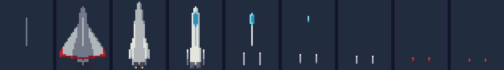
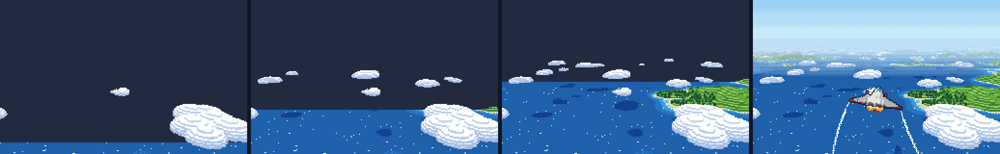
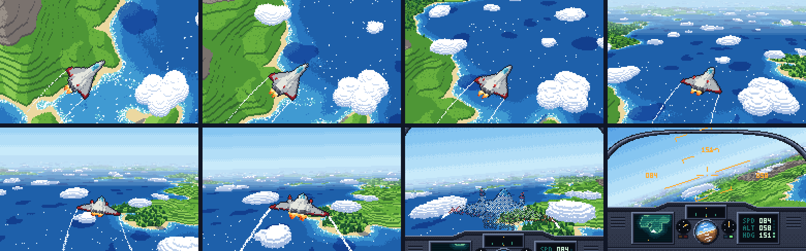
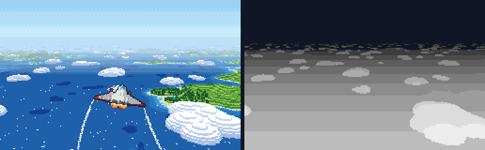
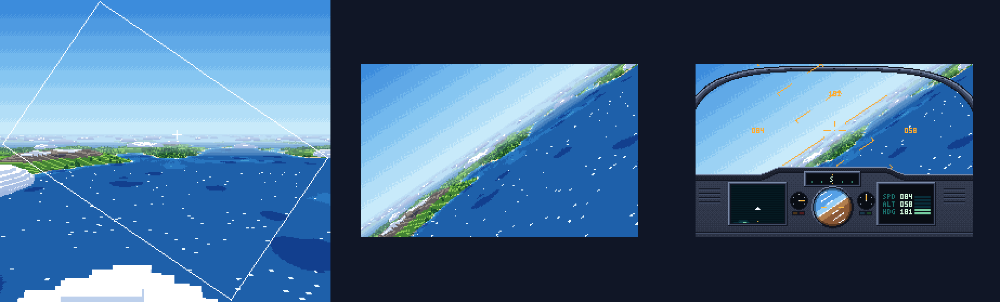

# How it works

This page is a tour of the six ideas behind games like Dash's "fighter". It is written for someone who has never written a renderer. Each idea has a picture, a plain explanation, the place it lives in the starter (`examples/starter/src`), and something to try.

You do not need to know any 3D maths. One formula appears, and it is explained.

When you want more than the tour, [A deeper look](deep-dive.md) works through each idea properly, and [the glossary](glossary.md) has every term.


## An honest description first

The game was announced as having "no 3D engine". As [Benathon pointed out](https://x.com/Benathon/status/2122115789319033270), that is not quite the right way to put it. There is a 3D engine. It is a very small one, written by hand, that colours a small picture one pixel at a time.

What the approach really leaves out:

- **No engine library.** Nothing like Three.js or Unity.
- **No polygons.** Nothing is a mesh of triangles.
- **No graphics card.** Every pixel is worked out by ordinary JavaScript. (Dash's game has one optional exception: a "realistic" flame style drawn by a small WebGL layer. It is off by default.)
- **No model files.** Shapes are numbers in the source code, or are made by code when the page loads.

## 1. One small picture

The whole game is drawn into a picture of about 400 × 240 pixels. The picture is a plain array with one number per pixel. Each number is a colour.

The page then shows that picture scaled up by a whole number (3 screen pixels per game pixel, for example) with smoothing switched off. That is where the chunky pixel look comes from. It is also why the game is fast: there are only about 100,000 pixels to work out.

Two rules give the picture its style:

- **Colours do not blend.** To fade something, draw fewer of its pixels, in a fixed pattern. This is called dithering. The trails thin out this way, and so does the craft when the camera moves into the cockpit.
- **Changes come in steps.** Distance haze has 8 levels, not a smooth gradient. The sky is 8 flat bands.

**In the starter:** `framebuffer.js` holds the picture. `main.js` scales it up and shows it.

**Try it:** make the browser window small, then large. The game picks a new pixel size each time, so the picture stays a few hundred pixels wide and the pixels stay square.

## 2. Sprite stacking

Take a 3D object and cut it into horizontal slices, like a loaf of bread. Each slice is a small flat pixel picture. Here are the slices of the starter's craft, from the belly up to the tips of the fins:



Now draw the slices from the bottom up, and draw each one a pixel higher on the screen than the one below. The pile looks solid. Turn every slice by the same angle and the object turns.


A stack is stored as a grid of numbers. Each number says which colour that cell is, and 0 means empty. The starter's craft is a grid 31 cells wide, 42 long and 11 layers tall, and it is built by a few loops in the code, so there is no image file.

To bank or pitch the craft, the whole grid is tilted in 3D before it is drawn. Every cell is then a tiny flat tile, and the renderer fills the pixels that the tile covers.

Two details make it read well:

- **Draw order.** Slices far from eye level are drawn first and slices near it are drawn last, so near slices cover far ones.
- **An outline.** After the stack is drawn, every empty pixel that touches it is painted dark. The craft then stands out over any background.

**In the starter:** `model.js` builds the grid. `stack.js` draws it.

**Try it:** press **E** while you fly. The slices pull apart, and you can see that the craft really is a pile of flat pictures.

## 3. The world is stacks too

The ground is a map with two numbers for every pixel: a **height** and a **material** (deep sea, sand, grass, rock, and so on). A ground pixel with height 6 is drawn as a column six layers tall, with the material's top colour on top and its side colour on the wall.

Clouds are a second, smaller map that holds how many layers thick the cloud is at each point. They float at a fixed height.

Both maps wrap. Fly off the east edge and you come back on the west, so the world never ends.

**Near to far.** The ground is drawn starting at the part of the view nearest the eye and working away from it. The picture below stops that sweep at three moments, and then shows the finished frame:



At each step of the sweep:

1. For every column of the screen, look up which ground pixel is there.
2. Work out which screen rows that column of ground covers.
3. Fill those rows, but only where nothing has been drawn yet.

Because nearer ground is drawn first, a hill hides whatever is behind it without any extra work. The renderer also remembers, for each screen column, the highest row the ground has reached. Ground hidden below that line is skipped after one comparison.

Whatever is still empty at the end is sky.

**In the starter:** `world.js` makes the maps from a seed. `terrain.js` draws them.

**Try it:** add `?seed=42` to the address. Every seed is a different world, and the same seed is always the same world.

## 4. One camera

This is the only formula. It turns a point in the world into a pixel on the screen.

```
scale = zoom / (1 + persp × depth)
x     = cx + scale × across
y     = cy − scale × (height + tilt × depth)
```

- `across`, `depth` and `height` say where the point is, measured from the spot the camera looks at: across the screen, into the screen, and upward.
- `cx`, `cy` is where that spot sits on the screen.
- `zoom`, `persp` and `tilt` are the camera's three settings.

Each view is a choice of those settings.

| View | `persp` | `tilt` | What that does |
| --- | --- | --- | --- |
| Overhead | 0 | 1 | Nothing shrinks with distance. Height and depth each move a point straight up the screen, one pixel per pixel. This is exactly the sprite-stack look |
| Chase | small | about 0.27 | Far things shrink and a horizon appears. The eye is behind the craft, looking a little down |
| Cockpit | larger | about 0 | The eye is inside the craft, looking straight ahead |

`persp` is 1 divided by the distance from the eye to the spot it looks at. So raising `persp` brings the eye closer. At 0 the eye is infinitely far away, which is why nothing shrinks.

**Changing view** slides the settings from one view's values to the next over about a second. Every frame on the way is a valid picture, so there is never a cut:



On the way into the cockpit the craft dissolves, because the eye is about to be inside it.

**In the starter:** `camera.js` holds the formula and the three poses. `game.js` slides between them.

**Try it:** press **Space** three times and watch the whole loop. Then press it twice quickly: the camera changes course half-way without a jump.

## 5. A depth for every pixel

Next to the colour array there is a second array of the same size. It holds, for every pixel, how far into the view the thing drawn there is. On the right below, near is light and far is dark:



The world fills this array in as it is drawn. Anything drawn afterwards checks it first. If the ground or a cloud at that pixel is nearer than the craft, the craft's pixel is skipped. That is how the craft passes behind a hill or disappears into a cloud.

Shadows use the maps directly. For a ground pixel, step toward the sun as far as the cloud layer is high, and look in the cloud map. If there is cloud there, this ground pixel is in shade. The craft's shadow works the same way with the craft's outline.

**In the starter:** `framebuffer.js` holds the depth array. `terrain.js` fills it and works out shadows. `stack.js` and `game.js` test it.

**Try it:** in the chase view, dive behind a hill or climb into a cloud. Watch the craft and its trails get cut off exactly at the edge.

## 6. A turned picture, and a cockpit over it

In the cockpit the horizon has to tilt when the craft banks. That is a problem, because the ground sweep in idea 3 works in upright screen columns. It cannot draw a slanted world.

So it does not try. The world is drawn upright, as always, onto a **sheet** that is bigger than the frame. Then the sheet is copied into the frame, turned by the bank angle about the point the camera looks at. The white outline on the left shows which part of the sheet ends up on screen:



The sheet is only as big as it needs to be for the current angle. Flying level, it is the same size as the frame and nothing is turned at all.

The cockpit itself is pixel art made by code, in two parts:

- **Painted once.** The canopy frame and the dashboard never change, so they are painted into two layers when the window changes size. Each frame they are copied over the world. The dashboard leans a little against a turn and shakes with the thrusters open, which is just a matter of copying it a pixel or two to one side.
- **Drawn every frame.** The instruments are drawn from the craft's own numbers: a map of the ground around the craft, a screen of speed, height and heading, a compass tape, an attitude ball, two needles and four lamps. The head-up display on the glass has a horizon line that stays on the real horizon however the craft banks.

**In the starter:** `roll.js` turns the sheet. `cockpit.js` paints and draws the cockpit, using the small drawing tools in `paint.js`.

**Try it:** in the cockpit, click to roll. The whole world turns once around you, and the attitude ball on the dashboard turns with it.

## Why it runs fast

- The picture is small.
- The ground is never drawn twice, because it is drawn near to far.
- Nothing is created while the game runs. Every array is made once and reused, so the browser never pauses to tidy up memory.
- Map sizes are powers of two, so wrapping a position costs one cheap operation.
- The cockpit's fixed parts are painted once, not every frame.

On a recent laptop the starter needs about 2 milliseconds for a 480 × 270 frame, in any view. A browser allows 16. `bun run check` measures it on your machine.

## The same world every time

All randomness comes from one seed number. The same seed always builds the same islands and clouds, and the same seed with the same input always draws the same frames. That makes a world shareable as a number, and it makes bugs repeatable. It is also why every picture on this page can be redrawn exactly with `bun run figures`.

**In the starter:** `rng.js`.

## How this differs from other old tricks

People guessed several classic techniques in the replies to Dash's post. Here is how they relate.

- **Mode 7** (Super Mario Kart, F-Zero) stretches one flat picture row by row to look like a floor. It has no height, so nothing can stand up from the ground or hide anything. Here every ground pixel has a height and hills hide what is behind them.
- **Voxel Space** (NovaLogic's *Comanche*, 1992) draws a height map column by column from near to far. This is the closest relative of the chase view, which is why Levi's prompt calls it "Comanche-style voxel terrain".
- **Ray marching** sends a ray through every pixel in a program that runs on the graphics card. Nothing here does that. The ground is drawn by walking over the map, not by sending rays.
- **Sprite stacking** is the name for the sliced craft. In the overhead view the islands and clouds are stacks in the same sense.

## What Dash's game adds

The starter stops at flight with three views. Dash's game goes much further with the same ideas:

- A richer cockpit: four layers at different distances that shift as the pilot's head sways, a radar, and colour schemes.
- Enemy jets, a cannon, lock-on missiles, a dodge that triggers slow motion, and a counter-attack.
- Crashes, an ejection seat, a parachute, and a new jet that catches the pilot.
- Clouds that part when a jet flies through them and close again, and a wake on the sea.
- A glow, vignette and film grain applied to the finished picture.
- Sound, touch buttons, gamepad support and a tutorial.

[reference-map.md](reference-map.md) says where each of these lives in his code, so you can read how it was done.

## Where to go next

- **Make something.** [The tutorial](tutorial.md) is eight small changes, each a few lines.
- **Understand it properly.** [A deeper look](deep-dive.md) explains why the formula has the shape it has, how a tile is filled, how big a step the sweep takes, and how the sheet is turned.
