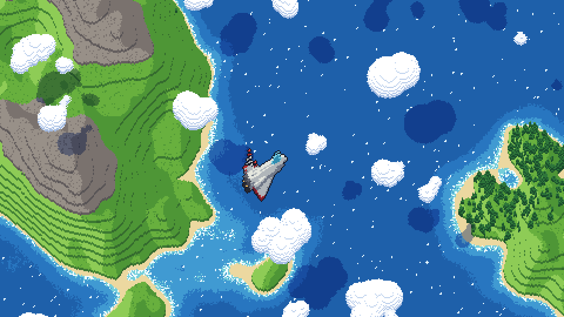

# How it works

This page explains the five ideas behind games like Dash's "fighter", in plain language, and points at where each one lives in the starter (`examples/starter/src`).

You do not need to know any 3D maths. One formula appears, and it is explained.

## An honest description first

The game was announced as having "no 3D engine". As [Benathon pointed out](https://x.com/Benathon/status/2122115789319033270), that is not quite the right way to put it. There is a 3D engine. It is a very small one, written by hand, that colours a small picture one pixel at a time.

What the approach really leaves out:

- **No engine library.** Nothing like Three.js or Unity.
- **No polygons.** Nothing is a mesh of triangles.
- **No graphics card.** Every pixel is worked out by ordinary JavaScript. (Dash's game has one optional exception: a "realistic" flame style drawn by a small WebGL layer. It is off by default.)
- **No model files.** Shapes are numbers in the source code, or are made by code when the page loads.

## 1. One small picture

The whole game is drawn into a picture of about 400 × 240 pixels. The picture is a plain array with one number per pixel. Each number is a colour.

The page then shows that picture scaled up by a whole number (3 screen pixels per game pixel, for example) with smoothing switched off. That is where the chunky pixel look comes from. It is also why the game is fast: there are only about 100,000 pixels to work out.

Two rules give the picture its style:

- **Colours do not blend.** To fade something, draw fewer of its pixels in a fixed pattern. This is called dithering. The trails thin out this way.
- **Changes come in steps.** Distance haze has 8 levels, not a smooth gradient. The sky is 8 flat bands.

In the starter: `framebuffer.js` holds the picture. `main.js` scales it up and shows it.

## 2. Sprite stacking

Take a 3D object and cut it into horizontal slices, like a loaf of bread. Each slice is a small flat pixel picture. The starter's craft is 11 slices of 31 × 42 pixels.

Now draw the slices from the bottom up, and draw each one a pixel higher on the screen than the one below. The pile looks solid. Turn every slice by the same angle and the object turns.

Press **E** in the starter to pull the slices apart and see them.



A stack is stored as a grid of numbers. Each number says which colour that cell is, and 0 means empty. To bank or pitch the craft, the whole grid is tilted in 3D before it is drawn. Every cell is then a tiny flat tile, and the renderer fills the pixels that the tile covers.

Two details make it read well:

- **Draw order.** Slices far from eye level are drawn first and slices near it are drawn last, so near slices cover far ones.
- **An outline.** After the stack is drawn, every empty pixel that touches it is painted dark. The craft then stands out over any background.

In the starter: `model.js` builds the grid. `stack.js` draws it.

## 3. The world is stacks too

The ground is a map with two numbers for every pixel: a **height** and a **material** (deep sea, sand, grass, rock, and so on). A ground pixel with height 6 is drawn as a column six layers tall, with the material's top colour on top and its side colour on the wall.

Clouds are a second, smaller map that holds how many layers thick the cloud is at each point. They float at a fixed height.

Both maps wrap. Fly off the east edge and you come back on the west, so the world never ends.

**Near to far.** The ground is drawn starting at the row of the view nearest the eye and working away from it. At each step:

1. For every column of the screen, look up which ground pixel is there.
2. Work out which screen rows that column of ground covers.
3. Fill those rows, but only where nothing has been drawn yet.

Because nearer ground is drawn first, a hill hides whatever is behind it without any extra work. The renderer also remembers, for each screen column, the highest row the ground has reached. Ground hidden below that line is skipped after one comparison.

Whatever is still empty at the end is sky.

In the starter: `world.js` makes the maps from a seed. `terrain.js` draws them.

## 4. One camera

This is the only formula. It turns a point in the world into a pixel on the screen.

```
scale = zoom / (1 + persp × depth)
x     = cx + scale × across
y     = cy − scale × (height + tilt × depth)
```

- `across`, `depth` and `height` say where the point is, measured from the spot the camera looks at: across the screen, into the screen, and upward.
- `cx`, `cy` is where that spot sits on the screen.
- `zoom`, `persp` and `tilt` are the camera's three settings.

**The overhead view** uses `persp = 0` and `tilt = 1`. With `persp` at zero, `scale` never changes, so nothing shrinks with distance. Height and depth each move a point straight up the screen, one pixel per pixel. That is exactly the sprite-stack look.

**The chase view** raises `persp`. Now `scale` gets smaller as `depth` grows, so far things shrink and a horizon appears. Lowering `tilt` makes the camera look out toward the horizon and less down at the ground.

**Changing view** slides `persp`, `tilt`, `zoom` and the camera's heading from one set of values to the other over about a second. Every frame on the way is a valid picture, so there is never a cut. Press Space in the starter to watch it.

In the starter: `camera.js` holds the formula. `game.js` slides the settings.

## 5. A depth for every pixel

Next to the colour array there is a second array of the same size. It holds, for every pixel, how far into the view the thing drawn there is.

The world fills it in. Anything drawn afterwards checks it first. If the ground or a cloud at that pixel is nearer than the craft, the craft's pixel is skipped. That is how the craft passes behind a hill or disappears into a cloud.

Shadows use the maps directly. For a ground pixel, step toward the sun as far as the cloud layer is high, and look in the cloud map. If there is cloud there, this ground pixel is in shade. The craft's shadow works the same way with the craft's outline.

In the starter: `framebuffer.js` holds the depth array. `terrain.js` fills it and works out shadows. `stack.js` and `game.js` test it.

## Why it runs fast

- The picture is small.
- The ground is never drawn twice, because it is drawn near to far.
- Nothing is created while the game runs. Every array is made once and reused, so the browser never pauses to tidy up memory.
- Map sizes are powers of two, so wrapping a position costs one cheap operation.

On a recent laptop the starter needs about 2 milliseconds for a 480 × 270 frame. A browser allows 16.

## The same world every time

All randomness comes from one seed number. The same seed always builds the same islands and clouds, and the same seed with the same input always draws the same frames. That makes a world shareable as a number, and it makes bugs repeatable.

In the starter: `rng.js`.

## How this differs from other old tricks

People guessed several classic techniques in the replies. Here is how they relate.

- **Mode 7** (Super Mario Kart, F-Zero) stretches one flat picture row by row to look like a floor. It has no height, so nothing can stand up from the ground or hide anything. Here every ground pixel has a height and hills hide what is behind them.
- **Voxel Space** (NovaLogic's *Comanche*, 1992) draws a height map column by column from near to far. This is the closest relative of the chase view, which is why Levi's prompt calls it "Comanche-style voxel terrain".
- **Ray marching** sends a ray through every pixel in a program that runs on the graphics card. Nothing here does that. The ground is drawn by walking over the map, not by sending rays.
- **Sprite stacking** is the name for the sliced craft. In the overhead view the islands and clouds are stacks in the same sense.

## What Dash's game adds

The starter stops at flight with two views. Dash's game goes much further with the same ideas:

- A cockpit view. The world is drawn onto a larger square sheet, the sheet is turned by the jet's bank angle, and a pixel-art cockpit with working instruments is laid on top.
- Enemy jets, a cannon, lock-on missiles, a dodge that triggers slow motion, and a counter-attack.
- Crashes, an ejection seat, a parachute, and a new jet that catches the pilot.
- Clouds that part when a jet flies through them and close again, and a wake on the sea.
- A glow, vignette and film grain applied to the finished picture.
- Sound, touch buttons, gamepad support and a tutorial.

[reference-map.md](reference-map.md) says where each of these lives in his code, so you can read how it was done.
